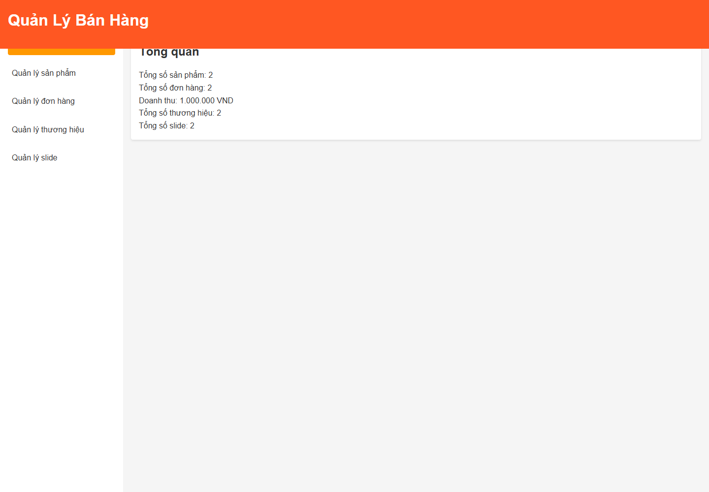

# Sales Management Demo

Giao diện quản lý bán hàng viết bằng HTML, CSS và JavaScript thuần, chạy trực tiếp trong trình duyệt.



## Chức năng hiện có

- Tổng quan số sản phẩm, đơn hàng, thương hiệu và doanh thu từ dữ liệu trong trang.
- Thêm, sửa và xóa sản phẩm.
- Hiển thị đơn hàng, thay đổi trạng thái đơn hàng.
- Quản lý thương hiệu và hình logo.
- Quản lý slide, hình ảnh và đường dẫn.

## Chạy demo

```bash
git clone https://github.com/daotrunghieuk4/Sales-Management-Demo.git
cd Sales-Management-Demo
python -m http.server 8080
```

Mở `http://localhost:8080`. Cũng có thể mở trực tiếp `index.html` trong trình duyệt. Toàn bộ giao diện, style và logic nằm trong tệp này, không cần cài thư viện JavaScript.

## Dữ liệu

Trang khởi tạo dữ liệu mẫu khi mở. Các thay đổi sản phẩm, thương hiệu và slide được giữ trong bộ nhớ JavaScript của trang và mất khi tải lại. Việc chọn hình dùng tệp trên máy để hiển thị trong phiên hiện tại. Tích hợp backend, lưu trữ lâu dài và kết nối sàn thương mại điện tử là các phần cần phát triển tiếp.
